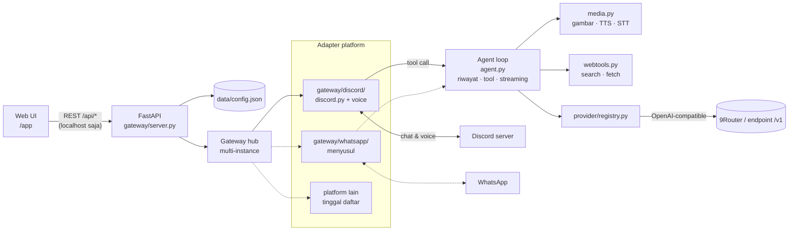

<div align="center">



<br />
<br />


<h1>Open Gateway</h1>

<p><strong>Gateway lokal yang menghubungkan model AI OpenAI-compatible ke platform chat.</strong><br />
Discord sudah aktif, WhatsApp menyusul, dan struktur <em>gateway adapter</em> dibuat supaya platform lain mudah ditambahkan.<br />
Chat, internet, gambar, dan suara — semuanya diatur dari satu web UI di <code>127.0.0.1</code>.</p>

<p>
  
  
  
  
  
  
</p>

</div>

---

## Daftar isi

- [Daftar isi](#daftar-isi)
- [Kenapa Open Gateway](#kenapa-open-gateway)
- [Fitur](#fitur)
- [Arsitektur](#arsitektur)
  - [Status platform](#status-platform)
- [Prasyarat](#prasyarat)
- [Instalasi](#instalasi)
- [Menjalankan](#menjalankan)
- [Tur web UI](#tur-web-ui)
  - [Tab Gateway](#tab-gateway)
  - [Tab AI Provider](#tab-ai-provider)
- [Menyiapkan gateway Discord](#menyiapkan-gateway-discord)
  - [Menambah platform lain](#menambah-platform-lain)
- [Perintah di Discord](#perintah-di-discord)
- [Provider \& model](#provider--model)
- [Data, token \& keamanan](#data-token--keamanan)
- [API admin](#api-admin)
- [Struktur proyek](#struktur-proyek)
- [Testing](#testing)
- [Troubleshooting](#troubleshooting)
- [Roadmap](#roadmap)

## Kenapa Open Gateway

- **Satu perintah, satu tempat.** `py main.py` menyalakan server, web UI, dan semua gateway chat yang aktif sekaligus.
- **Multi-platform, bukan satu bot.** Tiap platform punya *adapter* sendiri (`gateway/discord/`, `gateway/whatsapp/`); logika model, tool, dan riwayat dipakai bersama, jadi menambah platform baru tidak mengubah inti.
- **Provider bebas.** Sambungkan 9Router (lokal/remote) atau endpoint OpenAI-compatible apa pun; katalog model diambil otomatis dan dipakai lintas fitur (chat, gambar, TTS, STT, web).
- **Tanpa API key tambahan.** Pencarian web dan pembaca halaman punya implementasi bawaan; gambar punya cadangan gratis.
- **Local-first.** Tidak ada cloud, tidak ada akun, tidak ada `.env`. Konfigurasi dan token hanya tinggal di `data/config.json` di komputermu, dan API admin hanya menerima koneksi dari localhost.

## Fitur

| Fitur | Keterangan |
| --- | --- |
| 🖥️ **Web UI lokal** | FastAPI + UI tanpa framework; tema terang/gelap mengikuti sistem, tombol Start/Restart/Stop bot langsung dari browser. |
| 🔌 **Multi-provider** | `9Router` dan `OpenAI-compatible` umum. Katalog model dikelompokkan per jenis: chat, image, TTS, STT, web, embedding. |
| 🔎 **Pemilih model dengan pencarian** | Katalog 500+ model tetap ringan: 10 opsi pertama tampil, sisanya muncul saat mengetik. |
| 💬 **Gateway Discord** *(aktif)* | Pemicu balasan: mention/DM, prefix (`!ai`) di semua channel, atau semua pesan di satu channel. |
| 🧩 **Adapter multi-platform** | Jenis gateway terdaftar lewat `gateway_types.py`; tiap platform punya paketnya sendiri (`gateway/discord/`, `gateway/whatsapp/`). Inti model & tool tidak berubah saat platform baru ditambahkan. |
| 🌐 **Internet** | Model memakai tool `web_search` + `web_fetch`; memakai model search/fetch provider bila ada, jika tidak DuckDuckGo Lite/Bing + pembaca halaman bawaan. |
| 🖼️ **Gambar** | Tool `generate_image` dengan pilihan ukuran; bila model gambar provider gagal, otomatis jatuh ke pollinations.ai selama *Cadangan gratis* aktif. |
| 🎙️ **Suara** | Bot bisa masuk voice channel, mendengarkan (STT), lalu menjawab dengan TTS. |
| 🧠 **Kontrol percakapan** | System prompt, riwayat per channel (`max_history`), batas token jawaban (`max_tokens`). |
| 📊 **Status & log** | State bot, user, jumlah server, latency, uptime, pesan diproses, model aktif, error terakhir, plus log aktivitas realtime. |
| ⚡ **UI responsif** | Semua aksi (Start, Simpan, Muat ulang, Hapus, …) punya animasi loading supaya tidak ada klik ganda. |

## Arsitektur



Inti aplikasi (provider, model, tool, riwayat) tidak tahu platform apa yang sedang dipakai — semuanya lewat kontrak adapter: `gateway_types.py` mendaftarkan jenis + field-nya, `gateway/<platform>/` menyediakan hub-instance. Platform baru cukup menambah satu paket adapter dan satu entri metadata, tanpa menyentuh `agent.py`.

Alurnya singkat:

1. **AI Provider** menyimpan Base URL + API key, lalu menarik katalog model (`/v1/models`) dan menyimpannya sebagai cache.
2. **Gateway** menyimpan kredensial platform (mis. token Discord), provider + model terpilih, dan aturan balasan.
3. Saat pesan masuk, `agent.py` mengirim percakapan ke model. Bila model meminta tool, gateway menjalankan pencarian, pembacaan halaman, atau pembuatan gambar, lalu mengirim hasilnya kembali ke model.
4. Jawaban dikirim lewat adapter platform masing-masing; setiap langkahnya dicatat di panel **Aktivitas**.

### Status platform

| Platform | Status | Yang bisa dipakai |
| --- | --- | --- |
| Discord | ✅ Aktif | Chat + riwayat, internet, gambar, voice (dengar & bicara), perintah `!ai` |
| WhatsApp | 🚧 Card sudah ada di UI, backend menyusul | — |
| Platform lain | 📦 Siap ditambahkan lewat adapter | Tinggal daftar di `gateway_types.py` + paket `gateway/<platform>/` |

## Prasyarat

- **Python 3.11+** (diuji pada 3.13).
- **Bot Discord + token** dari [Discord Developer Portal](https://discord.com/developers/applications) — wajib mengaktifkan **Message Content Intent**.
- **ffmpeg** (opsional, hanya untuk suara) — `winget install Gyan.FFmpeg` di Windows, atau `apt install ffmpeg` di Linux.
- Akses ke provider AI: 9Router yang berjalan (default `http://localhost:20128`) atau endpoint OpenAI-compatible lain.

## Instalasi

```powershell
git clone https://github.com/Fattan-malva/Open-Masking.git
cd Open-Masking

py -m venv .venv
.\.venv\Scripts\Activate.ps1

pip install -r requirements.txt
```

Linux / macOS:

```bash
python3 -m venv .venv
source .venv/bin/activate
pip install -r requirements.txt
```

> Versi dependency dipatok di `requirements.txt` (tidak ada `@latest` / `>=` liar) agar build reproduksibel. Script ikon Lucide di web UI juga dipatok + diamankan dengan `integrity` (SRI).

## Menjalankan

```powershell
py main.py
```

- Web UI: `http://127.0.0.1:8787` → halaman depan, aplikasi ada di `/app`
- Health check: `http://127.0.0.1:8787/health`
- API admin: `http://127.0.0.1:8787/api/*` — **hanya bisa diakses dari localhost** (selain itu `403 forbidden`)

Browser terbuka otomatis. Host/port diatur di bagian `server` pada `data/config.json`:

```json
{
  "server": { "host": "127.0.0.1", "port": 8787, "open_browser": true }
}
```

File `data/config.json` **tidak dibuat saat aplikasi start** — file ini lahir saat kamu menambahkan provider atau gateway pertama. Ingin port lain sejak awal? Buat file di atas manual, lalu jalankan ulang.

## Tur web UI

### Tab Gateway

Daftar gateway menampilkan **satu card per jenis** (Discord, WhatsApp). Klik card untuk masuk ke detail; koneksi dibuat otomatis saat pertama dibuka, jadi tidak ada card "tambah" yang menumpuk.

Di dalam detail ada tiga blok:

1. **Status bot** — state, user, jumlah server, latency, uptime, pesan diproses, model aktif, dan error terakhir.
2. **Konfigurasi** — form utama:

   | Field | Fungsi |
   | --- | --- |
   | Provider AI | Sumber katalog model (diambil dari tab AI Provider). |
   | Discord bot token | Token bot; disimpan lokal dan hanya 4 karakter terakhir yang dikirim balik ke browser. |
   | Model AI | Model untuk chat. Daftar bisa 500+ model dan tetap bisa dicari. |
   | Pemicu balasan | `@mention/DM`, `prefix` (default `!ai`), atau semua pesan di satu channel. |
   | Riwayat pesan | Jumlah pesan konteks yang dikirim ke model (default 12). |
   | Maks. token jawaban | Batas panjang jawaban model (default 2048). |
   | System prompt | Kepribadian/instruksi dasar bot. |
   | Akses internet | Mengaktifkan tool `web_search`/`web_fetch`, plus model search & fetch opsional dan jumlah hasil. |
   | Gambar | Tool `generate_image`, model & ukuran, token pollinations opsional, serta cadangan gratis. |
   | Suara | Voice channel ID, auto-join, mode mendengar, bahasa, model TTS & STT. |

3. **Aktivitas** — log koneksi, pesan yang diproses, tool yang dipakai, dan error provider. Bisa dibersihkan.

Tombol **Simpan konfigurasi** langsung dipakai untuk pesan berikutnya (perubahan model/prompt); token baru perlu **Restart**. **Start / Restart / Stop** mengatur bot tanpa mematikan server, dan bot otomatis menyala saat aplikasi dibuka bila token sudah tersimpan.

### Tab AI Provider

Card per jenis provider (`9Router`, `OpenAI-compatible`). Di detail:

1. Isi **Base URL** (mis. `http://localhost:20128` untuk 9Router) dan **API key**.
2. Klik **Simpan** — gateway menarik katalog model semua jenis sekaligus.
3. Tabel model menampilkan id, owner, context length, dan badge `vision` / `tools` / `reasoning`; gunakan kolom cari untuk menyaring.
4. **Muat ulang model** mengambil katalog terbaru; **Hapus** membuang provider dari konfigurasi.

## Menyiapkan gateway Discord

Adapter Discord adalah yang aktif saat ini. Langkahnya:

1. Buka [Discord Developer Portal](https://discord.com/developers/applications) → **New Application**.
2. Tab **Bot** → aktifkan **Message Content Intent** (wajib; tanpa ini bot gagal start) → **Save**.
3. Salin **Bot Token** (Reset Token bila perlu).
4. Tab **OAuth2 → URL Generator** → scope `bot`, izin minimal:
   - Send Messages
   - Read Message History
   - Attach Files (untuk gambar)
   - Connect + Speak (untuk voice)
5. Buka URL hasil generator untuk mengundang bot ke server.
6. Tempel token di detail Gateway → **Simpan konfigurasi** → **Start**.

### Menambah platform lain

Kerangkanya sudah terpisah per platform, jadi adapter baru tidak menyentuh inti aplikasi:

1. **Daftarkan jenisnya** di `gateway/gateway_types.py` (`GATEWAY_TYPES`): `id`, `name`, `description`, `icon`, `available`, `coming_soon`. Card daftar, form detail, dan label di web UI otomatis ikut.
2. **Buat paket** `gateway/<platform>/` berisi *manager* per-instance (pola `gateway/discord/bot.py` → `DiscordBotManager`) dan *hub* yang menyimpannya berdasarkan `gateway_id` (pola `gateway/discord/hub.py` → `DiscordHub.get(gateway_id, create=True)`, `get_hub()`, `get_bot(gateway_id)`).
3. **Sambungkan ke API**: `gateway/admin.py` memakai hub untuk `start`/`stop`/`restart`/`logs` per gateway, dan `store.py` sudah menyimpan pengaturan per `gateway_id` — kredensial maupun preferensinya tidak perlu diubah bentuknya.

Bagian `agent.py`, `webtools.py`, `media.py`, dan `provider/` tidak tahu platform apa yang sedang dipakai; mereka hanya dipanggil oleh manager. Menambahkan WhatsApp (atau platform lain) berarti mengisi paket adapter, bukan menulis ulang logika model.

## Perintah di Discord

Perintah di bawah hanya berlaku untuk adapter Discord (platform lain punya perintahnya sendiri nanti).

| Perintah | Fungsi |
| --- | --- |
| `@bot halo` | Mengobrol dengan model (DM juga bisa) |
| `@bot cari harga bitcoin` | Model otomatis memakai internet bila perlu |
| `@bot buatkan gambar kucing astronot` | Model otomatis memakai tool gambar |
| `!ai gambar <deskripsi>` | Membuat gambar langsung tanpa lewat model chat |
| `!ai cari <kata kunci>` | Mencari di internet |
| `!ai buka <url>` | Membaca isi sebuah halaman |
| `!ai join [id]` | Masuk voice channel (atau channel tempat pengirim berada) |
| `!ai leave` | Keluar dari voice channel |
| `!ai dengar on\|off` | Mengaktifkan/mematikan mode mendengarkan |
| `!ai voice` | Status suara bot |
| `!ai reset` | Menghapus riwayat percakapan di channel |
| `!ai model` | Menampilkan model & fitur aktif |
| `!ai ping` | Cek latensi bot |
| `!ai help` | Menampilkan bantuan (alias `bantuan`) |

Prefix mengikuti pengaturan di tab Gateway. Riwayat disimpan terpisah per channel dan dibatasi **Riwayat pesan**. Di voice channel, bot memotong audio per jeda diam ~1,2 detik, melakukan transkripsi, meminta jawaban model, lalu membacakannya dengan TTS.

## Provider & model

| Jenis provider | Cocok untuk | Catatan |
| --- | --- | --- |
| `9Router` | Router lokal/remote dengan endpoint OpenRouter-style | Mendukung semua jenis: chat, image, TTS, STT, web, embedding. `/v1/models` butuh API key — tanpa itu balasannya `403`. |
| `OpenAI-compatible` | Endpoint umum (`/v1/chat/completions`, `/v1/models`) | Jenis tambahan (image/tts/stt/embedding) opsional; yang tidak tersedia diabaikan. |

Katalog disimpan sebagai cache di `data/config.json`, jadi pilihan model tetap ada saat aplikasi dibuka kembali. Kalau daftar model kosong atau berubah, klik **Muat ulang model** di detail provider.

## Data, token & keamanan

- Semua konfigurasi ada di **`data/config.json`** — provider (termasuk **API key**), gateway (termasuk **bot token**), cache katalog, dan bagian `server`.
- File itu dibuat **saat kamu menambah provider/gateway pertama**, bukan saat aplikasi start. Folder `data/` **diabaikan git**, jadi token tidak akan ikut ter-commit.
- Token Discord **tidak pernah** dikirim kembali ke browser; UI hanya menerima hint 4 karakter terakhir. API key provider selalu dikosongkan pada respons.
- Seluruh API admin dilindungi `require_local`: request dari selain `127.0.0.1`/`::1` ditolak `403`. Tidak ada endpoint publik, dan server default hanya listen di `127.0.0.1`.
- Jangan pernah commit isi `data/`, `.env`, atau file log. `.gitignore` sudah menyiapkan pola untuk itu.

## API admin

Semua endpoint hanya untuk localhost. Bentuk respons ringkas:

| Method | Path | Fungsi |
| --- | --- | --- |
| `GET` | `/api/status` | Status aplikasi, provider, gateway, voice |
| `GET` | `/api/provider/types` | Metadata jenis provider |
| `GET` | `/api/providers` | `{ types, providers[] }` |
| `POST` | `/api/providers` | Buat provider (`type`, `name`, `base_url`, `api_key`, `fetch`) |
| `GET` | `/api/providers/{id}` | Detail provider + katalog |
| `POST` | `/api/providers/{id}` | Simpan Base URL/API key, tarik katalog (`fetch`) |
| `POST` | `/api/providers/{id}/refresh` | Muat ulang katalog model |
| `DELETE` | `/api/providers/{id}` | Hapus provider |
| `GET` | `/api/gateway/types` | Metadata jenis gateway (`discord`, `whatsapp`) |
| `GET` | `/api/gateways` | `{ types, gateways: [{ settings, status }] }` |
| `POST` | `/api/gateways` | Buat gateway baru (`type`) |
| `GET` | `/api/gateways/{id}` | `{ settings, status, logs }` |
| `POST` | `/api/gateways/{id}` | Simpan konfigurasi gateway |
| `POST` | `/api/gateways/{id}/start` · `/stop` · `/restart` | Kontrol bot |
| `DELETE` | `/api/gateways/{id}` | Hapus gateway |
| `GET` | `/api/gateways/{id}/logs` | Log aktivitas |
| `POST` | `/api/gateways/{id}/logs/clear` | Bersihkan log |

> Endpoint lama ber-bentuk tunggal (`/api/gateway`, `/api/gateway/start`, …) masih tersedia sebagai alias untuk gateway pertama, demi kompatibilitas skrip lama.

## Struktur proyek

```
main.py                    Launcher: baca data/config.json -> uvicorn
gateway/
  config.py                Konstanta & path (APP_NAME, VERSION, DATA_DIR, WEB_DIR)
  store.py                 Persistensi data/config.json (save atomik)
  server.py                FastAPI: /app, /, /health, static /assets
  admin.py                 REST admin (localhost-only)
  gateway_types.py         Metadata jenis gateway (discord, whatsapp)
  agent.py                 Loop tool-calling ke model
  webtools.py              web_search & web_fetch tanpa API key
  media.py                 Gambar (dengan fallback), TTS, STT
  discord/
    bot.py                 Bot, perintah, riwayat, log
    hub.py                 Manajer multi-gateway
    voice.py               Voice channel: join, dengar, bicara
  whatsapp/                Placeholder gateway WhatsApp
provider/
  registry.py              Jenis provider + pengambilan katalog
  client.py                Klien OpenAI-compatible (chat/image/tts/stt)
  nine_router/client.py    Endpoint khusus 9Router (catalog/web)
public/
  index.html · app.js · style.css · theme.js
  landing.html             Halaman depan
  favicon.svg · icon-*.svg Aset merek
tests/                     Unit test (pytest)
data/                      config.json — gitignored
.github/assets/banner.svg  Banner README
```

## Testing

```powershell
py -m pytest tests -q
```

Cakupan: penyimpanan konfigurasi, API admin, klien provider, media, dan perilaku bot Discord (dengan Discord di-mock). 72 tes, tanpa perlu token asli.

## Troubleshooting

| Gejala | Solusi |
| --- | --- |
| `[Errno 10048]` saat start | Port sudah dipakai. Tutup proses lain, atau ubah `server.port` di `data/config.json`. |
| `PrivilegedIntentsRequired` | Aktifkan **Message Content Intent** di Developer Portal, lalu Restart. |
| `LoginFailure` | Token salah/di-reset. Simpan token baru, lalu Restart. |
| Model tidak muncul | Pastikan Base URL berakhiran `/v1` dan API key valid, lalu **Muat ulang model**. Untuk 9Router, `/v1/models` membalas `403` tanpa API key. |
| Model 429 / 503 / 504 | Kuota model gratis habis atau upstream sedang down. Pilih model lain. |
| Gambar gagal | Biasanya kuota model gambar habis. Biarkan **Cadangan gratis** aktif agar memakai pollinations.ai (tanpa token: 1 gambar / 45 detik per IP). Isi token pollinations per gateway atau variabel `OG_POLLINATIONS_TOKEN`. |
| Suara tidak keluar | Pastikan `ffmpeg` ada di `PATH`, bot punya izin Connect + Speak, dan model TTS dipilih. Cek `!ai voice`. |
| Bot tidak mendengar | Pastikan `PyNaCl` + `discord-ext-voice-recv` terpasang, model STT dipilih, dan mode dengar aktif (`!ai dengar on`). |
| `403 forbidden` di `/api/*` | Kamu mengakses dari host selain localhost. Buka lewat `127.0.0.1`. |
| Web UI tidak berubah setelah update | Browser meng-cache aset. Hard refresh: `Ctrl+Shift+R`. |

## Roadmap

- [x] Multi-provider (9Router + OpenAI-compatible)
- [x] Chat, internet, gambar, suara
- [x] Web UI lokal dengan pemilih model yang bisa dicari
- [ ] Gateway WhatsApp (card sudah tampil, backend menyusul)
- [ ] Ekspor/impor konfigurasi gateway
- [ ] Dukungan slash command Discord

---

<div align="center">

Dibuat untuk dipakai sendiri di lokal — jalankan, atur dari browser, biarkan bot yang bekerja.

</div>
